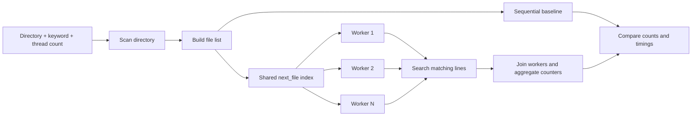

# Parallel File Search Using Threads

A command-line Operating Systems hackathon project that searches text files concurrently using **C and POSIX threads (`pthreads`) on Ubuntu/Linux**. It runs a sequential baseline and a parallel search over the same file set, then compares result counts and elapsed time.

> **Project team:** Shanmukha · L. Sainath · R. Nishanth  
> **Course:** Operating Systems Hackathon

## Overview

Searching files one at a time can become slow for large collections. This project distributes independent file-search tasks among a configurable number of worker threads while synchronizing access to shared state.

### Features

- Searches regular files directly inside a directory (not recursive).
- Performs **case-insensitive substring matching**.
- Prints matching file path, line number, matching text, and worker ID.
- Supports a user-selected number of POSIX worker threads.
- Runs sequential and parallel searches against the same directory.
- Uses mutexes for safe task allocation and readable console output.
- Reports matching file/line counts, elapsed times, and the observed speedup.
- Checks whether sequential and parallel counts agree.
- Includes a small test dataset and a larger synthetic benchmark dataset.

## System design




### Synchronization

- `task_mutex` protects the shared `next_file` index so workers claim unique file indexes.
- `output_mutex` protects printed results so messages from different workers do not overlap unpredictably.
- Each worker keeps its own counters. The main thread combines them after `pthread_join()` completes.

## Technologies

| Technology | Purpose |
|---|---|
| C | Search logic, data structures, and resource management |
| Ubuntu/Linux | Execution environment and file-system APIs |
| GCC | Compilation |
| POSIX threads (`pthreads`) | Worker-thread creation, joining, and synchronization |
| GNU C library | File/string operations, including `strcasestr()` |
| `clock_gettime(CLOCK_MONOTONIC)` | Elapsed-time measurement |

No third-party packages are required for the core program.

## Requirements

- Ubuntu or another Linux environment with a GNU C library
- GCC and `make` (installed through `build-essential`)
- Terminal access

Install the required build tools if they are not already installed:

```bash
sudo apt update
sudo apt install build-essential
```

## Build / compilation

Open a terminal in the repository directory (the directory containing `parallel_search.c`).

### Option 1: Compile directly

```bash
gcc -std=c11 -Wall -Wextra -Wpedantic -O2 parallel_search.c -o parallel_search -pthread
```

### Option 2: Use the Makefile

```bash
make
```

To remove the compiled executable:

```bash
make clean
```

## Execution

```bash
./parallel_search <directory> <keyword> <thread_count>
```

Arguments:

- `directory`: directory containing the files to search
- `keyword`: search text; matching is case-insensitive
- `thread_count`: positive number of worker threads for the parallel phase

### Example: search the included sample files

```bash
./parallel_search test_data error 4
```

The included five-file fixture should report **3 matching files and 4 matching lines** in both sequential and parallel modes.

### Try other searches

```bash
# Search with two worker threads
./parallel_search test_data error 2

# Search for a keyword that is not present; expected matching counts are zero
./parallel_search test_data banana 4

# Search the larger synthetic dataset
./parallel_search benchmark_data CRITICAL 4
```

To search for a phrase containing spaces, put the keyword in quotes:

```bash
./parallel_search test_data "memory error" 4
```

### Sample output (format)

Exact output and timing values depend on the dataset and machine. A typical final summary looks like this:

```text
========== FINAL RESULTS ==========
Sequential matching files : 3
Parallel matching files   : 3
Sequential matching lines : 4
Parallel matching lines   : 4

Sequential execution time : <measured seconds>
Parallel execution time   : <measured seconds>
Speedup                    : <measured ratio>x
Correctness check          : PASS (counts match)
===================================
```


## Testing

| Test | Command / scenario | Expected check |
|---|---|---|
| Keyword present | `./parallel_search test_data error 4` | 3 matching files and 4 matching lines in both modes |
| Case-insensitive search | Search `error`, `ERROR`, or `Error` | Case differences do not affect matching |
| No match | `./parallel_search test_data banana 4` | Zero matching files and lines |
| Different worker counts | Run with `1`, `2`, and `4` workers | Sequential and parallel totals remain equal |
| Empty directory | Run against an empty directory | Clear “No regular files found” message |
| Invalid thread count | Use `0` as the thread count | Program rejects the input |
| Larger workload | `./parallel_search benchmark_data CRITICAL 4` | 12 matching files and 24 matching lines in the included benchmark fixture |

## Recorded benchmark result

One recorded run on the included synthetic dataset (300 files, approximately 105,000 lines, keyword `CRITICAL`, four worker threads) produced the following result:

| Metric | Recorded value |
|---|---:|
| Matching files (both modes) | 12 |
| Matching lines (both modes) | 24 |
| Sequential elapsed time | 0.016138 seconds |
| Parallel elapsed time | 0.005357 seconds |
| Observed speedup | 3.01× |


**Important:** These timing values are from one captured run and are not a performance guarantee. Thread creation/joining, CPU scheduling, file-system caching, storage speed, and workload size can all affect timing. Small datasets may run slower in parallel. Re-run the command on your own Ubuntu machine and use its output for any local performance claim.

Speedup is calculated as:

```text
Speedup = sequential elapsed time / parallel elapsed time
```

## Repository structure

```text
.
├── README.md
├── parallel_search.c
├── Makefile
├── test_data/                 # Five small sample text files
├── benchmark_data/            # 300 synthetic text files for performance tests
└── assets/
    ├── architecture.png
    ├── flowchart.png
    ├── sample_run.png
    ├── ubuntu_compile.png
    └── benchmark_results.png
```

## Current limitations

- Searches only the specified directory level; nested subdirectories are not traversed.
- Intended for text files, not binary file analysis.
- Uses a fixed-size 4096-byte line buffer, so exceptionally long lines can be read in chunks.
- Timing results are affected by the machine and current system conditions.
- The interface is terminal-based; no graphical UI is included.

## Future improvements

- Recursive directory traversal
- File-extension filters and options to skip large files
- Robust handling of very long lines and binary files
- Progress reporting and cancellation
- Exportable CSV/JSON results
- Repeated benchmarks with environment details and average/variance calculations

## Operating Systems concepts demonstrated

- POSIX thread creation and lifecycle: `pthread_create()` and `pthread_join()`
- Shared-memory concurrency
- Race-condition prevention with mutexes
- File and directory I/O
- Thread-local counters and post-join aggregation
- Dynamic memory management
- Performance comparison between sequential and parallel execution

## References

- Silberschatz, Galvin, and Gagne, *Operating System Concepts*, 10th edition, Wiley, 2018.
- Michael Kerrisk, *The Linux Programming Interface*, No Starch Press, 2010.
- [GNU Compiler Collection documentation](https://gcc.gnu.org/onlinedocs/)
- [Linux man-pages project](https://man7.org/linux/man-pages/)
